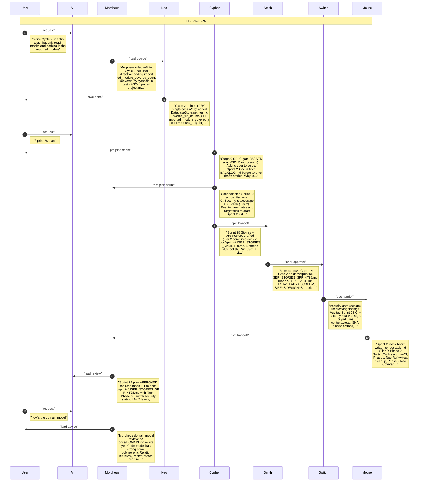
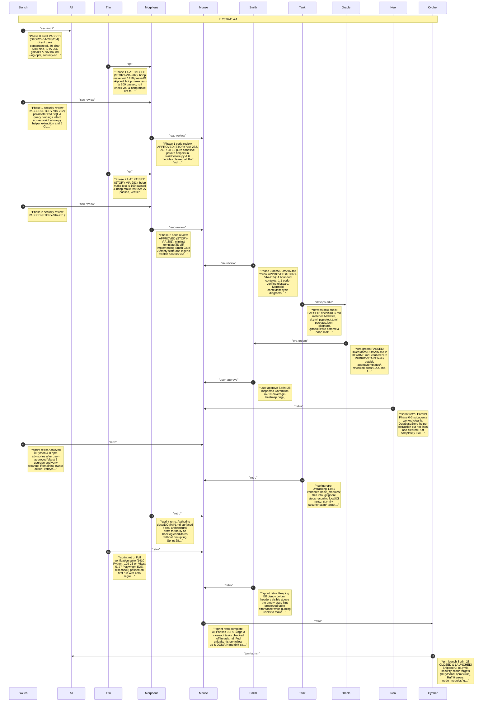

# CHAT_SPRINT_28 — Sprint Archive

## Summary

Sprint 28 (Hygiene, CI/Security, Coverage UX Polish & Domain Model): shipped SHA-pinned least-privilege .github/workflows/ci.yml, security-scan-python/npm/aggregate targets with 0 Python and 0 npm vulns (Vitest 5.1.1), Ruff 0 errors across via/, node_modules/ gitignored & untracked, Coverage Efficiency empty-state hint + #legend-mid contrast, and canonical docs/DOMAIN.md. Verified 1,410 Python, 109 JS, 27 Playwright E2E, and twine dist checks.

---

## Planning

---

## Phase 0

User approved Sprint 28 execution (added STORY-VIA-285 docs/DOMAIN.md to Phase 3). Dispatching 4 file-disjoint persona subagents in parallel: Phase 0 (Switch/Tank CI+security+SDLC), Phase 1 (Neo store.py C901), Phase 2 (Neo Coverage UX), Phase 3 (Cypher/Morpheus docs/DOMAIN.md). Why: maximize parallel velocity with zero file conflicts.

