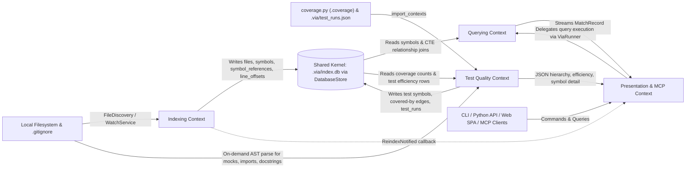
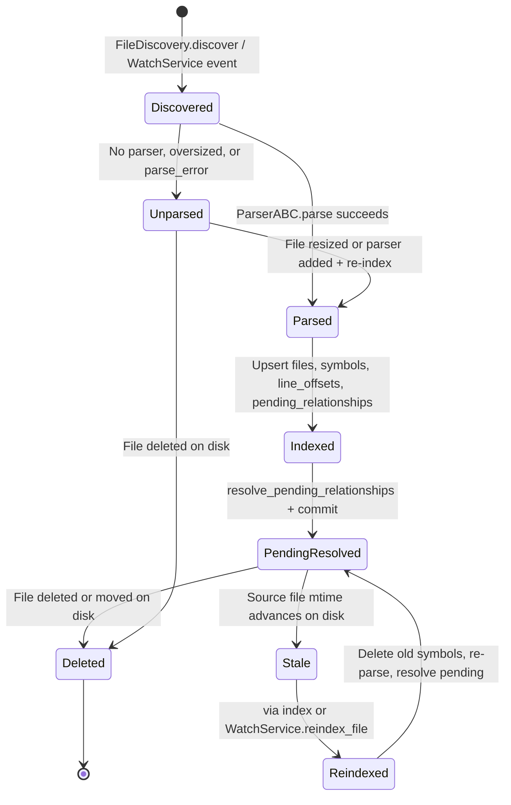

# Domain Model: VIA Code Intelligence Platform

*   **Bounded Contexts**: `Indexing`, `Querying`, `Test Quality`, `Presentation & MCP`
*   **Status**: Active
*   **Domain Owners**: Cypher (*pm), Morpheus (*lead)
*   **Last Updated**: 2026-11-25

---

## 1. Executive Summary & Strategic Context

VIA is a local-first code intelligence platform that discovers and parses multi-language repositories into a denormalized SQLite symbol and relationship graph (`.via/index.db`), enabling fast structural queries, relationship traversal, per-test coverage attribution, and developer/AI-agent consumption over CLI, Web UI, and MCP stdio. Rather than acting as a compiler or full type-checker, VIA models source code as a lightweight, byte-offset-addressable symbol graph optimized for millisecond lookups, incremental re-indexing, and blast-radius / test-quality analysis.

The domain is organized into four bounded contexts that currently share a single SQLite persistence kernel (`DatabaseStore` in `via/db/store.py`):

1. **Indexing Context** — Discovers repository files, applies `.gitignore` and size policies, parses source files (Python, JavaScript/TypeScript, Dart, Markdown) into structural symbols and line byte-offset maps, resolves two-pass cross-file relationships, and keeps the index fresh via filesystem watching.
2. **Querying Context** — Compiles CLI flags, fluent programmatic specs, canned templates, and deterministic English natural-language queries into executable pipeline stages (`PipelineStage`) that filter symbols by pattern, type, subtype, language, recency, body content, and positive/negative/chained/polymorphic relationships.
3. **Test Quality Context** — Imports per-test dynamic coverage contexts (`.coverage` from `pytest --cov-context=test`) and per-test execution metadata (`.via/test_runs.json`) into the index, and computes hierarchical coverage intensity, peer-group outlier flags, mock-only test detection, and on-demand symbol drill-down details.
4. **Presentation & MCP Context** — Projects streaming `MatchRecord` results into human- and machine-readable views (list, table, raw source slices, syntax-formatted code, Mermaid class diagrams, usage/docstrings, JSON), serves the embedded Web UI and JSON HTTP API, and exposes structured tools (`via_query`, `via_ask`) to AI agents over MCP stdio.

* **In-Scope Capabilities:**
  * Multi-language structural symbol extraction (`PythonParser`, `JavaScriptParser`, `DartParser`, `MarkdownParser`) with exact line/byte spans.
  * Two-pass cross-file relationship graph construction (`inherits-from`, `calls`, `imports`, `references`, `declares`, `http-calls`, `covered-by`) and incremental mtime/watchdog updates.
  * Composable pipeline querying (`--via`, `--sans`, chained CTE filters, polymorphic relation categories, temporal `--newerthan`/`--olderthan`/`--stale` predicates, `--contains` body filtering, `--slice` pagination, `--canned` templates, and Lark-based `via ask`).
  * Per-test coverage attribution (`via coverage import-contexts`) and test-suite quality analytics (coverage intensity icicle hierarchy, leave-one-out peer-group outlier detection, symbols-per-second efficiency, static AST mock/import analysis).
  * Multi-format rendering (`RendererFactory`), embedded Web UI (`WebServer`), and MCP stdio server (`run_mcp_server`).
* **Out-of-Scope:**
  * Full semantic type inference, compiler diagnostics, IDE refactoring/edits, or language-server (LSP) symbol renaming (e.g., Dart imports are captured as directive strings, not resolved pub graphs).
  * Running test suites directly or storing historical multi-run test-result time series (`test_runs` is explicitly latest-run upsert-only).
  * Multi-tenant remote hosting, authentication/authorization, or distributed index synchronization (VIA operates strictly on local filesystem repositories and local SQLite databases).
* **Upstream Contexts / External Inputs:**
  * `Local Filesystem & Gitignore Rules` — Source files, `.gitignore`, file mtimes, and OS filesystem notifications (`watchdog`).
  * `External Test Runner Artifacts` — `coverage.py` SQLite context files (`.coverage`) and `pytest` plugin metadata (`.via/test_runs.json`).
  * `Human & AI Callers` — Terminal CLI invocations, browser Web UI requests, Python API callers (`ViaQueryBuilder`), and MCP clients.
* **Downstream Consumers:**
  * `CLI Users` (stdout formatted via `via/renderers/`).
  * `Web UI SPA` (`GET /`, `/api/status`, `POST /api/query`, `/api/coverage/hierarchy`, `/api/coverage/test-efficiency`, `/api/coverage/symbol`).
  * `AI Agents / MCP Hosts` (consuming `via_query` and `via_ask` JSON/rendered payloads over stdio).
  * `Programmatic Python Scripts` (consuming `ViaQueryBuilder` and `ViaRunner` from `via/api/query_builder.py`).

---

## 2. Ubiquitous Language (Glossary)

Every term below maps directly to its verified implementation in the `via/` package (or is explicitly marked if conceptual/unimplemented).

### Indexing Context

| Business Term | Kind | Definition in this context | Code Mapping |
|---|---|---|---|
| **Discovered File** | Value Object | Snapshot of a candidate repository file's absolute path, size, mtime, parseability, and oversize status after `.gitignore` and default exclusion filtering. | `via/core/discovery.py:DiscoveredFile` |
| **File Discovery** | Domain Service | Directory tree crawler that filters ignored paths (`PathFilter`) and emits `DiscoveredFile` descriptors. | `via/core/discovery.py:FileDiscovery` |
| **Indexed File** | Entity | Persistent record of a repository file tracked in the index, keyed by project-relative path, storing language, size, mtime, `indexed_at`, `parsed`, and `oversized` flags. | `via/db/schema.py:files` (`CREATE_FILES_TABLE`), `via/db/store.py:DatabaseStore` |
| **Language Parser** | Domain Service | Language-specific extractor that transforms raw file bytes into a `ParseResult` containing structural symbol entities and raw call/reference edges. | `via/parsers/base.py:ParserABC`, `via/parsers/registry.py:ParserRegistry` (`PythonParser`, `JavaScriptParser`, `DartParser`, `MarkdownParser`) |
| **Parse Result** | Value Object | Transient per-file extraction output holding typed entity lists (`ClassEntity`, `FunctionEntity`, `ImportEntity`, `GlobalEntity`, `MarkdownHeadingEntity`, `CallEntity`, `ReferenceEntity`, `StringConstantEntity`, `LinkEntity`, `LogStatementEntity`) and optional `parse_error`. | `via/parsers/base.py:ParseResult` |
| **Symbol** | Entity | A named, addressable structural unit stored in the denormalized `symbols` table (code declaration, file/path anchor, markdown heading, string constant, link, or synthetic external/test node) with line/byte coordinates and `qualified_name`. | `via/db/schema.py:symbols` (`CREATE_SYMBOLS_TABLE`), `via/core/types.py:SymbolType` |
| **Line Offset Map** | Value Object | Per-file mapping from 1-based line numbers to `(byte_offset, byte_length)` enabling O(1) `-mL` line-slice extraction without rescanning files. | `via/db/schema.py:line_offsets`, `via/services/indexing.py:IndexingService._index_line_offsets` |
| **Pending Relationship** | Entity | An unresolved cross-file edge (`source_id`, `target_name`, `rel_type`) queued during pass 1 of indexing and resolved or discarded in pass 2 once all symbols exist. | `via/db/schema.py:pending_relationships`, `via/db/store.py:DatabaseStore.resolve_pending_relationships` |
| **Indexing Service** | Domain Service | Orchestrates discovery, incremental mtime checks, parsing, transactional persistence, and pending-relationship resolution; returns `IndexingStats`. | `via/services/indexing.py:IndexingService`, `IndexingStats` |
| **Watch Service** | Domain Service | Observes filesystem changes via `watchdog`, debounces rapid saves (default 500 ms), triggers single-file re-indexing or deletion, and notifies registered re-index listeners. | `via/services/watch.py:WatchService`, `_ViaEventHandler` |

### Querying Context

| Business Term | Kind | Definition in this context | Code Mapping |
|---|---|---|---|
| **Symbol Kind** | Value Object | Enumeration of first-class queryable symbol types: `method`, `class`, `function`, `filepath`, `filename`, `import`, `global`, `header`, `string_constant`, `link`. *(See Drift #1 for DB-only kinds.)* | `via/core/types.py:SymbolType` |
| **Match Operator** | Value Object | Pattern comparison semantics mapping CLI syntax to SQL/Python execution: `exact` (`=`), `glob` (`GLOB`), `like` (`LIKE`), `regexp` (Python `re.search`). | `via/core/types.py:MatchOp` |
| **Reference Type** | Value Object | Canonical persisted edge label in `symbol_references.reference_type`: `inherits-from`, `calls`, `imports`, `references`, `declares`, `covered-by`, `http-calls`. | `via/core/relationship_types.py:ReferenceType` |
| **Relation** | Policy / Value Object | Polymorphic query-side relationship hierarchy wrapping `ReferenceType` + direction (`inverted` flag). Concrete leaves (`Calls`, `CalledBy`, `Declares`, `DeclaredIn`, `CoveredBy`, `Covers`, etc.) resolve directly; category nodes (`Any`, `UpstreamRef`, `DownstreamRef`) expand dynamically via `__subclasses__()` into their concrete leaves. | `via/core/relationship_types.py:Relation`, `Any`, `UpstreamRef`, `DownstreamRef`, `resolve_relation`, `execute_relation` |
| **Relationship Filter** | Value Object | Parsed parameters for a `--via` (positive) or `--sans` (`NOT EXISTS`) graph constraint, including anchor pattern, anchor types, inversion, temporal bounds, and `--stale` flag. | `via/pipeline/relationship_filter.py:RelationshipFilter` |
| **Pipeline Stage** | Value Object | Single executable step (`MATCH`, `RENDER`, or `STATS`) paired with its parsed argument namespace. | `via/pipeline/types.py:PipelineStage`, `StageType` |
| **Pipeline Executor** | Domain Service | Runs an ordered list of `PipelineStage`s through `STAGE_REGISTRY` (`MatchStageHandler`, `RenderStageHandler`, `StatsStageHandler`), streaming `Iterator[MatchRecord]` between stages. | `via/pipeline/executor.py:PipelineExecutor`, `via/pipeline/handlers.py:STAGE_REGISTRY` |
| **Match Record** | Value Object / DTO | Typed query result row produced by `MatchRecordFactory` for a matched symbol (`ClassMatchRecord`, `MethodMatchRecord`, `FunctionMatchRecord`, `FileMatchRecord`, `ImportMatchRecord`, `GlobalMatchRecord`, `HeaderMatchRecord`, `StringConstantMatchRecord`, `LinkMatchRecord`). *(See Drift #2.)* | `via/core/match_record.py:MatchRecord`, `MatchRecordFactory` |
| **Fluent Query** | Command / Value Object | Programmatic builder (`ViaQueryBuilder`, `RelationshipQueryBuilder`) compiling into an immutable `ViaQuery` executed by `ViaRunner`. | `via/api/query_builder.py:ViaQueryBuilder`, `ViaQuery`, `ViaRunner` |
| **Canned Query** | Command Template | Named reusable query template (built-in or `.via/canned/*.json`) expanded with `{arg}` placeholders into standard CLI argv. | `via/canned.py:load_canned_queries`, `expand_canned_query` |
| **Natural Query** | Command | Deterministic English query compiled via Lark EBNF grammar into standard VIA CLI pipeline arguments (no LLM involved). | `via/pipeline/natural_query.py:LarkNaturalQueryParser`, `QueryTransformer` |
| **Query Error** | Value Object | Structured machine-readable failure payload (`code`, `message`, `hint`) shared across CLI, MCP, and API layers. | `via/pipeline/errors.py:QueryError`, `PipelineParseError` |

### Test Quality Context

| Business Term | Kind | Definition in this context | Code Mapping |
|---|---|---|---|
| **Test Symbol** | Entity | Synthetic symbol (`symbol_type='test'`, `file_path='<test>'`) representing one pytest node ID, serving as the target anchor for per-test `covered-by` edges. | `via/commands/coverage.py:_link_covered_symbols`, `TEST_SYMBOL_FILE_PATH` |
| **Test Run** | Entity | Latest execution outcome (`status`, `duration_seconds`, `last_run_at`) for a single canonical `test_id`, upsert-only with no historical log. | `via/db/schema.py:test_runs`, `via/db/store.py:DatabaseStore.upsert_test_run` |
| **Coverage Intensity** | Value Object | Percentage score for a production symbol equal to `covering_test_count * 100` (fan-in of distinct tests covering the symbol), aggregated upward across package/module/class ancestors as the mean of all leaf descendants. | `via/web/api/coverage.py:build_coverage_hierarchy`, `get_coverage_hierarchy` |
| **Peer-Group Outlier** | Policy | Flag (`is_outlier`) marking a symbol whose `covering_test_count` exceeds `z > 2.0` via leave-one-out statistics against peers sharing `(symbol_type, is_constructor_like)`, evaluated only when peer group size `>= 10`. | `via/web/api/coverage.py:_compute_outliers`, `_CONSTRUCTOR_LIKE_NAMES`, `_OUTLIER_Z_THRESHOLD`, `_MIN_PEER_GROUP_SIZE` |
| **Test Efficiency Metric** | Value Object | On-demand per-test diagnostic combining persisted `duration_seconds` and `covered_symbol_count` (`symbols_per_second`) with live AST-derived `mock_call_count`, `imported_module_covered_count`, and `mocks_only` flag (`mock_call_count > 0` and `imported_module_covered_count == 0`). | `via/web/api/coverage.py:get_test_efficiency`, `_analyze_test_file` |
| **Coverage Leaf Detail** | Value Object | On-demand drill-down for a heatmap leaf combining indexed symbol metadata with live-parsed Python signature and docstring. | `via/web/api/coverage.py:get_symbol_detail`, `_extract_signature_and_docstring` |

### Presentation & MCP Context

| Business Term | Kind | Definition in this context | Code Mapping |
|---|---|---|---|
| **Renderer** | Domain Service | Output projection transforming an `Iterator[MatchRecord]` into a concrete `RenderType` (`list`, `table`, `diagram`, `usage`, `raw`, `formatted`, `json`) and `FormatType` (`ascii`, `md`, `html`, `png`). | `via/renderers/factory.py:RendererFactory`, `via/core/match_record.py:RenderType`, `FormatType` |
| **Web Server** | Infrastructure Service | Embedded `ThreadingHTTPServer` daemon serving the Web UI SPA and JSON endpoints (`/api/health`, `/api/status`, `/api/query`, `/api/coverage/*`), tracking live `reindex_state`. | `via/web/server.py:WebServer`, `via/web/handler.py:ViaRequestHandler` |
| **MCP Server** | Infrastructure Service | Stdio MCP server exposing `via_query` and `via_ask` tools backed by a dedicated read-only `DatabaseStore` while running `WatchService` (and optional `WebServer`) in background daemon threads. | `via/mcp/server.py:run_mcp_server`, `_build_mcp_app`, `via/mcp/schema.py:build_tool_schema` |

### Alternative or Deprecated Terms

| Forbidden / Deprecated Term | Preferred Ubiquitous Term | Rationale |
|---|---|---|
| `RelationshipType` | `ReferenceType` (persistence/API) or `Relation` (query hierarchy) | `RelationshipType = ReferenceType` in `via/core/relationship_types.py` is only a backward-compatibility alias; using it blurs the distinction between stored edge strings (`ReferenceType`) and directional/polymorphic query predicates (`Relation`). |
| `has` (Web API relationship alias) | `declares` | `via/web/api/query.py:_REL_MAP` maps `"has"` to `"declares"` for legacy UI compatibility; domain language uses `declares` / `declared-in` for structural containment. |
| `coverage.xml` / blanket suite coverage (`<coverage>`) | Per-test coverage contexts (`<test>` / `covered-by`) | Sprint 27 replaced whole-suite `coverage.xml` attribution with per-test `pytest --cov-context=test` attribution; `COVERAGE_ARTIFACT_FILE_PATH = '<coverage>'` is retained only to purge legacy rows on import. |
| `IndexCommand` | `IndexCommandHandler` | `IndexCommand = IndexCommandHandler` in `via/commands/index.py` is a legacy alias; all CLI command handlers follow the `*CommandHandler` convention (`CommandHandlerABC`). |
| `MatchRecord` as a pure Domain Entity | `MatchRecord` (Query DTO / Renderable Projection) | `MatchRecord` currently bundles rendering metadata (`column_widths`, `total_matches`) and CLI mixins (`ArgumentProvider`, `HelpProvider`); treating it as a pure persistence entity obscures its presentation coupling. |

---

## 3. Context Map and Model

### Integration Relationships
* **Indexing ↔ Querying (Shared Kernel via `DatabaseStore`):** Both contexts operate directly on `.via/index.db` through `DatabaseStore`. Indexing owns schema migrations (`SCHEMA_VERSION = 8`) and all structural writes; Querying reads via `match()`, `query_relationships()`, `query_negative_relationships()`, and `query_relationships_chained()`.
* **Indexing → Presentation & MCP (In-Process Event Callback):** `WatchService` invokes `WebServer.notify_reindex(files_changed)` after each debounced re-index so `GET /api/status` reflects live watch activity.
* **Test Quality ↔ Indexing (Conformist to `symbols` & `symbol_references`):** `via/commands/coverage.py` reuses `ParserRegistry` to map covered line numbers onto existing indexed `symbols` rows and writes synthetic `symbol_type='test'` nodes plus `covered-by` edges into `symbol_references`.
* **Presentation & MCP → Querying (Open Host Service / Published Language):** CLI (`PipelineParser`), Web (`via/web/api/query.py`), MCP (`via_query`, `via_ask`), and Python callers (`ViaQueryBuilder`) all converge on `ViaRunner` / `PipelineExecutor` and `MatchRecord`.

### Entities vs. Value Objects Summary

* **Entities (Identity-based, mutable lifecycle):**
  * `IndexedFile` (`files` row): Identity defined by `files.id` and unique natural key `files.path` (project-relative). Mutated on re-index (`mtime`, `size_bytes`, `indexed_at`, `parsed`, `oversized`) and removed on file deletion.
  * `Symbol` (`symbols` row): Identity defined by `symbols.id` (surrogate PK) and logical tuple `(symbol_name, symbol_type, file_path, parent_name)` used by `DatabaseStore.get_symbol_id()`. Replaced wholesale whenever its owning file is re-indexed.
  * `PendingRelationship` (`pending_relationships` row): Identity defined by `id`; ephemeral entity created in pass 1 and deleted during `resolve_pending_relationships()`.
  * `SymbolReference` (`symbol_references` row): Identity defined by `id`, linking `(from_symbol_id, to_symbol_id, reference_type)`. Cascade-deleted whenever either endpoint symbol is deleted.
  * `TestRun` (`test_runs` row): Identity defined by canonical `test_id` (PK). Mutated via upsert (`ON CONFLICT(test_id) DO UPDATE`) on each coverage import.
* **Value Objects (Attribute-based, equality by value):**
  * `DiscoveredFile`, `ParseResult`, and parser entities (`ClassEntity`, `FunctionEntity`, `ImportEntity`, `GlobalEntity`, `MarkdownHeadingEntity`, `CallEntity`, `ReferenceEntity`, `StringConstantEntity`, `LinkEntity`, `LogStatementEntity`).
  * `SymbolType`, `MatchOp`, `ReferenceType`, `Relation` subclasses, `StageType`, `RenderType`, `FormatType`.
  * `RelationshipFilter`, `PipelineStage`, `ViaQuery` (frozen dataclass), `QueryError` (frozen dataclass), `IndexingStats`.
  * `MatchRecord` subclasses (transient read DTOs; mutable in practice because `anchor_mtime` and `total_matches` are attached post-construction by `DatabaseStore` / `PipelineExecutor`).

### Known Architectural & Domain Drifts (Recorded Honestly)

The current codebase exhibits four concrete domain/architectural drifts documented here as baseline truth for future refactoring:

1. **`SymbolType` Enum Incomplete vs. Persisted `symbols.symbol_type`:** `via/core/types.py:SymbolType` defines 10 members (`method`, `class`, `function`, `filepath`, `filename`, `import`, `global`, `header`, `string_constant`, `link`), omitting `'test'` (inserted by `via/commands/coverage.py`), `'external_class'` (inserted by `DatabaseStore._get_or_create_external_class_symbol()`), and `'module'` (inserted by `DatabaseStore._get_or_create_module_symbol()` / `resolve_pending_relationships()`). `MatchRecordFactory._RECORD_TYPES` works around this by mapping `'test'` → `GlobalMatchRecord`, `'external_class'` → `ClassMatchRecord`, and `'module'` → `ImportMatchRecord`, while SQL queries in `DatabaseStore` special-case `'external_class'` and `'module'`.
2. **`MatchRecord` Carries Presentation & CLI Concerns:** `via/core/match_record.py:MatchRecord` is used as the core query result DTO across `DatabaseStore` and `PipelineExecutor`, yet it holds rendering-only fields (`column_widths`, `total_matches`), implements `supports_render_type()`, and inherits CLI mixins (`ArgumentProvider`, `HelpProvider`) from `via/core/interfaces.py`.
3. **`DatabaseStore` Multi-Concern Concentration:** `via/db/store.py:DatabaseStore` (~2,240 lines) acts as a single monolithic gateway spanning four distinct concerns: schema migrations & Indexing writes/two-pass resolution, Querying SQL/regex/CTE graph execution, `MatchRecordFactory` hydration, and Test Quality read aggregations (`get_symbol_coverage_counts`, `get_test_efficiency_data`, `get_test_covered_file_counts`, `get_symbol_detail`).
4. **Dual Relationship Vocabulary & Persisted vs. On-Demand Test Quality Split:**
   * *Dual relationship vocabulary:* CLI `PipelineParser` resolves user relationship names into `Relation` subclasses (supporting polymorphic categories `Any`, `UpstreamRef`, `DownstreamRef`), whereas `ViaQueryBuilder` and `via/web/api/query.py` still construct `RelationshipFilter` using plain `ReferenceType` enum values. `execute_relation()` in `via/core/relationship_types.py` duck-types across both, alongside the legacy `RelationshipType = ReferenceType` alias.
   * *Persisted vs. on-demand Test Quality split:* Per-test `covered-by` edges and `test_runs` metadata are persisted in SQLite at import time (`via/commands/coverage.py`), whereas mock counts (`mock_call_count`), imported-module coverage (`imported_module_covered_count`), `mocks_only` detection, leave-one-out peer-group outlier detection (`_compute_outliers`), LOC icicle aggregation, and symbol signatures/docstrings (`_extract_signature_and_docstring`) are computed on-demand at HTTP request time by re-parsing Python source files with `ast` in `via/web/api/coverage.py`.

---

## 4. Aggregates & Business Invariants

Aggregates define transactional consistency boundaries enforced in SQLite and service-layer orchestration.

### Aggregate Root: `IndexedFile`

* **Root Entity:** `files` row (identified by `files.id` / unique relative `files.path`)
* **Boundary Members:**
  * Owned `symbols` rows whose `file_path` matches the file's absolute path (including `filepath` and `filename` anchor symbols, plus extracted declarations/headers/strings/links).
  * Owned `line_offsets` rows (`FOREIGN KEY (file_id) REFERENCES files(id) ON DELETE CASCADE`).
  * Intra-file `declares` and string-constant `references` edges created during `_store_symbols()`.
* **Business Invariants (Must ALWAYS Be True):**
  1. *Unique Path Identity:* `files.path` is `UNIQUE NOT NULL` and stored relative to `DatabaseStore.index_root` (`_to_relative_path()`), while `symbols.file_path` stores the absolute path for source extraction.
  2. *No Orphaned Symbols on Re-index or Deletion:* Re-indexing a file via `_upsert_file()` deletes all prior `symbols` for that `file_path` before inserting fresh symbols; removing or single-file re-indexing via `DatabaseStore.delete_file_completely()` runs an explicit `BEGIN ... COMMIT` transaction deleting `symbols` and `files` atomically (cascading `symbol_references`, `pending_relationships`, and `line_offsets` under `PRAGMA foreign_keys = ON`).
  3. *Oversize & Unparseable Guard:* Files exceeding `size_limit` (default 10 MB) or lacking a registered parser / failing with `parse_error` are recorded in `files` (`parsed = 0`, `oversized = 1` when oversized) without inserting partial symbol graphs.
  4. *Batch Atomicity:* `IndexingService.index()` wraps all file upserts, symbol inserts, line-offset writes, and pending-relationship resolution in a single `begin_transaction()` / `commit_transaction()` block, rolling back entirely on unhandled failure.
  5. *Line Offset Monotonicity:* For every parsed file with non-empty content, `line_offsets` stores a contiguous `(file_id, line_number)` primary key starting at line 1 matching the exact byte spans of the indexed file content.

### Aggregate Root: `SymbolGraph`

* **Root Entity:** Cross-file directed graph in `symbol_references` + staging queue `pending_relationships`
* **Boundary Members:**
  * Resolved edges (`symbol_references`: `from_symbol_id`, `to_symbol_id`, `reference_type`).
  * Unresolved pass-1 edges (`pending_relationships`: `source_id`, `target_name`, `rel_type`).
  * Synthetic external anchor symbols (`file_path = '<external>'`, `symbol_type IN ('module', 'external_class')`).
* **Business Invariants (Must ALWAYS Be True):**
  1. *Referential Integrity:* Every `symbol_references` endpoint (`from_symbol_id`, `to_symbol_id`) and every `pending_relationships.source_id` MUST reference an existing `symbols.id` (`ON DELETE CASCADE`, enforced by `PRAGMA foreign_keys = ON`).
  2. *Two-Pass Queue Drain:* Every indexing commit and every `WatchService` single-file `reindex_file()` MUST run `resolve_pending_relationships()`, which resolves each pending entry (preferring definitions in order `class > function > method > global > module`, synthesizing `<external>` `module`/`external_class` anchors for unresolved `imports`/`inherits-from`) and deletes every processed row from `pending_relationships` so the staging table is empty at rest.
  3. *Canonical `declares` Direction & Container Guard:* Structural containment edges are always stored `member (from_symbol_id) -> container (to_symbol_id)` with `reference_type = 'declares'`. Queries using `--via declares` / `--via declared-in` reject any container type outside `{'file', 'class', 'filepath', 'filename', None}` (`PipelineExecutor._compile_relationship_params` / `_execute_single_relationship_query`).
  4. *Query Composition Guards:* `--limit` and `--slice` are mutually exclusive (`PipelineExecutor._resolve_limit_and_offset`, `ViaQueryBuilder.build`); relationship categories (`Any`, `UpstreamRef`, `DownstreamRef`) cannot be chained across multiple `--via`/`--sans` filters in a single query (`PipelineExecutor._execute_match_stage`); `--stale` requires non-null `symbols.mtime`.

### Aggregate Root: `TestRun` & Per-Test Coverage Attribution

* **Root Entity:** `test_runs` (keyed by `test_id`) + synthetic `<test>` symbol set in `symbols` and `covered-by` edges in `symbol_references`
* **Boundary Members:**
  * `test_runs` rows (`test_id`, `status`, `duration_seconds`, `last_run_at`).
  * Synthetic `symbols` rows with `symbol_type = 'test'` and `file_path = '<test>'`.
  * `symbol_references` rows with `reference_type = 'covered-by'` linking `production_symbol (from_symbol_id) -> test_symbol (to_symbol_id)`.
  * On-demand computed read models (`build_coverage_hierarchy`, `get_test_efficiency`, `get_symbol_detail`) in `via/web/api/coverage.py`.
* **Business Invariants (Must ALWAYS Be True):**
  1. *Clean-Slate Per-Test Semantics on Import:* `import_contexts()` MUST delete all prior `<coverage>` (legacy aggregate) and `<test>` symbols (cascade-deleting old `covered-by` edges) before inserting new per-test links so old and new coverage runs never mix.
  2. *Attribution Requires Dynamic Context:* Coverage lines recorded under an empty context (module import time outside any test) are never attributed to a test (`_covered_lines_by_test()`).
  3. *Latest-Run Upsert Only:* `test_runs` stores at most one row per `test_id`; re-importing overwrites `status`, `duration_seconds`, and `last_run_at` in place.
  4. *No Double-Counting Container Classes in Heatmap:* `_drop_redundant_class_rows()` removes a class's direct row whenever it has method children so ancestor `intensity_pct` is strictly the mean across all leaf descendants, never a mean of means.
  5. *Statistical Peer-Group Outlier Floor:* `_compute_outliers()` only flags `is_outlier = True` when a leaf's peer group `(symbol_type, is_constructor_like)` has at least `_MIN_PEER_GROUP_SIZE = 10` members and its leave-one-out z-score exceeds `_OUTLIER_Z_THRESHOLD = 2.0` (or differs from a zero-variance baseline).
  6. *Path-Traversal Isolation:* All on-demand AST file reads in `via/web/api/coverage.py` MUST pass `_resolve_under_root(index_root, rel_path)` using `os.path.realpath` + `os.path.commonpath`, rejecting any path escaping `index_root`.
  7. *Thread-Isolated SQLite Access:* Web HTTP handlers (`ViaRequestHandler`) open a fresh `DatabaseStore` connection per request, and MCP (`run_mcp_server`) uses separate `watch_store` (write) and `mcp_store` (read) connections in SQLite WAL mode.

---

## 5. Lifecycle

Every source file and its derived symbols follow a well-defined indexing lifecycle managed by `FileDiscovery`, `IndexingService`, `DatabaseStore`, and `WatchService`.

### State Transition Matrix

| Current State | Triggering Command / Event | Next State | Guard Condition / Invariant |
|---|---|---|---|
| `[*]` | `FileDiscovery.discover()` or watchdog `on_created` | `Discovered` | File passes `PathFilter` (`.gitignore` + `CORE_DEFAULT_EXCLUDES`); for `WatchService`, extension must be in `WATCHED_EXTENSIONS` (`.py`, `.pyx`, `.pyi`, `.md`). |
| `Discovered` | `IndexingService._index_file()` | `Unparsed` | `file_info.is_oversized` (`> 10 MB`), or `!file_info.is_parseable`, or `parse_result.parse_error` is non-empty; recorded via `_upsert_raw_file()` with `parsed=False`. |
| `Discovered` | `ParserABC.parse(path, content)` | `Parsed` | Registered parser found in `ParserRegistry` and returns `ParseResult` with `parse_error is None`. |
| `Parsed` | `IndexingService._store_parsed_file()` | `Indexed` | Prior symbols for `file_path` cleared if updating; `files`, `symbols`, intra-file `declares`, `pending_relationships`, and `line_offsets` written inside active transaction. |
| `Indexed` | `DatabaseStore.resolve_pending_relationships()` + `commit_transaction()` | `PendingResolved` | All `pending_relationships` rows resolved (or synthesized as `<external>` for `imports`/`inherits-from`) and drained; transaction commits cleanly. |
| `PendingResolved` | External edit updates file on disk (`mtime > files.mtime`) | `Stale` | Detected by `IndexingService._should_index_file()` on next `via index`, or by `--stale` relationship post-filter comparing `r.mtime < r.anchor_mtime`. |
| `Stale` | `via index` (or `via index --force`) / `WatchService._reindex_file()` | `Reindexed` | For `WatchService`, 500 ms debounce timer expires and `os.stat(path)` succeeds; `reindex_file()` executes `delete_file_completely()` then `_index_file()` + `resolve_pending_relationships()`. |
| `PendingResolved` / `Unparsed` | Watchdog `on_deleted` / `on_moved` (src) or missing file during `_reindex_file()` | `Deleted` | `DatabaseStore.delete_file_completely(path)` atomically deletes `symbols` (cascading `symbol_references`) and `files` (cascading `line_offsets`). *(Note: batch `via index` does not currently prune deleted files automatically; watch mode handles deletions.)* |

---

## 6. Domain Events

VIA does not run an external message broker; domain events are realized as OS filesystem callbacks, in-process listener hooks, and command-completion boundaries. Implementation side-effects (such as SQLite WAL checkpointing or log formatting) are excluded.

| Event Name | Trigger Condition | Key Payload Properties | Primary Consumers / Subscribers |
|---|---|---|---|
| **`FileChanged`** | OS emits create, modify, delete, or move under `root_dir` for an included file in `WATCHED_EXTENSIONS` (`_ViaEventHandler` → `WatchService._schedule()`), coalesced by a per-path debounce timer (default `0.5s`). | `{path, action: 'created' \| 'modified' \| 'deleted'}` | `WatchService._execute()` → `IndexingService.reindex_file()` or `DatabaseStore.delete_file_completely()`. |
| **`IndexCompleted`** | `IndexingService.index()` commits its SQLite transaction after indexing discovered files and resolving pending relationships. | `IndexingStats {total_files, indexed_files, skipped_files, oversized_files, failed_files, duration_seconds, functions, classes, imports, globals}` | `IndexCommandHandler.run()` (prints summary + triggers `StatsCommand`), `WatchService.start()` (transitions from initial sync to live observation). |
| **`CoverageImported`** | `via coverage import-contexts [path]` (`via/commands/coverage.py:import_contexts()`) clears stale coverage symbols, writes per-test `covered-by` edges, and upserts `test_runs` from `.via/test_runs.json`. | `{project_root, data_file, imported_edges_count, test_count, runs_imported}` | `Querying Context` (`--via covered-by` / `--via covers` / `--sans covered-by`), `Test Quality Context` (`GET /api/coverage/hierarchy`, `GET /api/coverage/test-efficiency`, `GET /api/coverage/symbol`). |
| **`ReindexNotified`** | `WatchService._execute()` finishes a debounced non-delete re-index and invokes `_notify_reindex_listeners(files_changed)` with exception isolation. | `{files_changed: int}` → captured by `WebServer.notify_reindex()` as `{count, last_count, last_time (ISO8601 UTC)}` | `WebServer.notify_reindex()` (registered in `via/commands/index.py` and `via/mcp/server.py`), exposed to the Web UI SPA via `GET /api/status` (`via/web/api/status.py`). |
